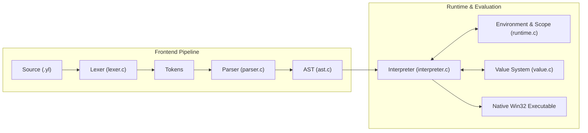

<div align="center">
  

  <h1>Yalu</h1>

  <p><strong>A language of its own.</strong></p>

  <p>
    <a href="#license"></a>
    
    
    
    
  </p>
</div>

---

## Table of Contents

1. [Project Introduction](#1-project-introduction)
2. [What is Yalu?](#2-what-is-yalu)
3. [Design Philosophy](#3-design-philosophy)
4. [Key Features](#4-key-features)
5. [Language Architecture](#5-language-architecture)
6. [Installation](#6-installation)
7. [Building from Source](#7-building-from-source)
8. [Running Yalu Programs](#8-running-yalu-programs)
9. [Interactive REPL](#9-interactive-repl)
10. [Syntax Overview](#10-syntax-overview)
11. [Variables and Data Types](#11-variables-and-data-types)
12. [Conditional Statements](#12-conditional-statements)
13. [Loops](#13-loops)
14. [Functions and Recursion](#14-functions-and-recursion)
15. [Classes and Objects](#15-classes-and-objects)
16. [Arrays and Books](#16-arrays-and-books)
17. [Modules and Imports](#17-modules-and-imports)
18. [String Interpolation](#18-string-interpolation)
19. [Error Handling](#19-error-handling)
20. [Code Examples](#20-code-examples)
21. [Project Structure](#21-project-structure)
22. [Current Development Status](#22-current-development-status)
23. [Roadmap](#23-roadmap)
24. [Testing](#24-testing)
25. [Contributing](#25-contributing)
26. [License](#26-license)
27. [Creator Attribution](#27-creator-attribution)
28. [AI-Assisted Development Acknowledgment](#28-ai-assisted-development-acknowledgment)
29. [Contact & Project Links](#29-contact--project-links)

---

## 1. Project Introduction

**Yalu** is an independent, dynamically typed programming language implemented entirely from scratch in native C (C11). It compiles directly to a standalone native binary (`yalu.exe`) on Windows with zero external library dependencies beyond the standard C runtime.

Yalu introduces a clean, expressive syntax characterized by deliberate delimiters (`<<"" ... "">>`, `::`, `!!`, `>>`), native key-value dictionary mappings called **Books**, rich array manipulation methods, object-oriented capabilities, a relative module loading system, and robust runtime diagnostics.

---

## 2. What is Yalu?

Yalu is neither a clone nor a wrapper around existing scripting engines. It possesses its own:
- **Handwritten Lexer**: Scans distinctive multi-character delimiters, string interpolations, and comment structures.
- **Recursive Descent Parser**: Constructs an Abstract Syntax Tree with operator precedence climbing.
- **Tree-Walking Interpreter**: Evaluates expressions, handles control flow, and dispatches native methods.
- **Scoped Runtime**: Manages environment symbol tables, reference-counted heap values, and module caching.

---

## 3. Design Philosophy

- **Zero External Dependencies**: The core runtime and interpreter require only standard ANSI C11 headers.
- **Expressive Syntax**: Distinct delimiters make code unambiguous to read and parse.
- **Safe Defaults**: Automatic recursion depth guards, circular reference detection during object printing, and cycle-protected module imports.
- **Developer Clarity**: Informative compile-time and runtime diagnostics featuring source line previews and visual caret pointers.
- **Lightweight Footprint**: Fast startup times and a standalone binary under 200 KB.

---

## 4. Key Features

- **Embedded Windows Application Icon**: Official multi-resolution PE icon embedded directly in `yalu.exe`.
- **First-Class Data Structures**:
  - **Lists**: Zero-indexed heterogeneous arrays with negative indexing, nested index assignment, concatenation (`<>`), and mutating methods (`inc`, `rem`, `rep`, `haveit`).
  - **Books**: Insertion-order-preserving key-value dictionaries declared via `..` and `<>`, with reverse lookups and methods (`add`, `edval`, `edkey`).
- **Object-Oriented System**: Classes (`class /Point < ... >`), constructors (`fn inti !!<yclass, ...>>`), implicit instance references (`yclass`), property access (`>`), and structural formatting (`fullclass`, `yalupr`).
- **Control Flow**:
  - While loops (`lp !!condition!! :: ... ::`) with `bk` (break) and `cn` (continue).
  - For loops (`fr !!i in 1@max, j = ","!! :: ... ::`) supporting numeric ranges, variables, collections, character iteration, and output separators.
  - Multi-branch conditionals (`if`, `:ei`, and `<<""else"">>`).
- **Immediate Return**: Clean return semantics via `place` (and backward-compatible `rt`).
- **Modular Architecture**: Relative file imports (`use [./module]`) with extension auto-resolution, symbol exporting, and circular import prevention.
- **String Interpolation**: Simple embedded expressions (`/#identifier`, `/#object>property`).
- **Validated Input**: `inp.str`, `inp.int`, and `inp.flo` with custom prompts and format checking.
- **Type Inspection**: Built-in `type(...)` returning uppercase type names for single or multiple expressions.

---

## 5. Language Architecture



See [docs/architecture.md](docs/architecture.md) for the complete architecture guide.

---

## 6. Installation

### Pre-Built Binaries
Download the latest Windows x64 release from the repository's releases section. Extract `yalu.exe` to a directory of your choice and add it to your system `PATH`.

### System Requirements
- **Operating System**: Windows 10 or Windows 11 (64-bit)
- **Architecture**: x86_64 / AMD64

---

## 7. Building from Source

### Prerequisites
- A C11-compliant compiler: **Clang** (recommended via LLVM-MinGW or LLVM) or **GCC** (via MinGW-w64).
- Windows resource compiler: `llvm-rc` or `windres`.
- PowerShell 5.1+ (for automated test suite execution).

### Option A: Using `build.bat` (Recommended)

Run the automated build script from Command Prompt or PowerShell:

```cmd
build.bat
```

This compiles `src/yalu.rc` into the executable, builds release `yalu.exe` and debug `yalu_debug.exe`, and runs the full automated test suite.

### Option B: Using Make

```bash
make release
make debug
make test
```

### Option C: Using CMake

```bash
cmake -B build -S .
cmake --build build --config Release
```

> [!NOTE]
> Yalu's core C code is portable across POSIX systems. However, Windows resource script embedding (`src/yalu.rc`) and Win32 taskbar icon calls (`WM_SETICON`) are conditionally compiled for Windows hosts.

---

## 8. Running Yalu Programs

Execute any Yalu script (`.yl`) directly:

```powershell
yalu.exe main.yl
yalu.exe run main.yl
```

Validate syntax without executing:

```powershell
yalu.exe check main.yl
```

Display version and help:

```powershell
yalu.exe --version
yalu.exe --help
```

---

## 9. Interactive REPL

Launch the interactive Read-Eval-Print Loop by running `yalu.exe` without arguments:

```text
Yalu Programming Language [Windows x64]
Version: 0.3.0
Target: Native Windows Executable
Type 'exit' or 'quit' to exit REPL.

yl> pr "Hello from REPL!"
Hello from REPL!
yl> book = { name .. "ali", age .. 18 }
yl> pr book>name
ali
yl> quit
```

---

## 10. Syntax Overview

```yl
<<"" Comments are enclosed in double-bracket delimiters "">>
name = "Yalu"
version = 0.3

<<"" String interpolation "">>
pr "Welcome to /#name version /#version!"

<<"" Collections & Methods "">>
list = [10, 20, 30]
list>>inc(40)

<<"" Iteration with custom separator "">>
fr !!item in list, j = ","!! ::
    pr item
::
```

---

## 11. Variables and Data Types

Yalu supports dynamic typing across 10 runtime types:

| Type | Description | Example |
| :--- | :--- | :--- |
| `INTEGER` | 64-bit signed integer | `count = 100` |
| `FLOAT` | 64-bit IEEE 754 float | `pi = 3.14159` |
| `BOOLEAN` | First-class boolean | `flag = Tr`, `done = Fl` |
| `STRING` | UTF-8 dynamic string | `msg = "hello"` |
| `LIST` | Dynamic indexed collection | `arr = [1, "two", 3.0]` |
| `BOOK` | Key-value dictionary | `dict = { key .. val }` |
| `CLASS` | Class definition schema | `class /Point < ... >` |
| `INSTANCE` | Instantiated class object | `pt = /Point(1, 2)` |
| `FUNCTION` | Callable function | `fn add !!<a, b>>!! :: ... ::` |
| `NULL` | Null singleton | `empty = Null` |

---

## 12. Conditional Statements

Conditional blocks use `if`, `:ei` (else if), and `<<""else"">>`. Conditions are surrounded by `!!` and blocks by `::`:

```yl
score = 85

if !!score >= 90!! ::
    pr "Grade: A"
:ei !!score >= 80!! ::
    pr "Grade: B"
<<""else"">>
    pr "Grade: C"
::
```

---

## 13. Loops

### While Loop (`lp`)
```yl
i = 0
lp !!i < 5!! ::
    pr "Iteration: /#i"
    i += 1
    if !!i == 4!! ::
        bk  <<"" Break statement "">>
    ::
::
```

### For Loop (`fr`)
```yl
<<"" Numeric range with variable "">>
max = 4
fr !!i in 1@max!! ::
    pr i
::

<<"" Collection loop "">>
items = ["apple", "banana", "cherry"]
fr !!item in items!! ::
    pr item
::

<<"" String iteration with separator parameter j "">>
fr !!ch in "hello", j = ","!! ::
    pr ch  <<"" Prints: h,e,l,l,o "">>
::
```

---

## 14. Functions and Recursion

Declare functions using `fn` with parameter lists enclosed in `!!< ... >>!!`. Return values using `place`:

```yl
fn factorial !!<n:int>>!! ::
    if !!n <= 1!! ::
        place 1
    ::
    place n * factorial(n - 1)
::

result = factorial(5)
pr "5! = /#result"  <<"" 120 "">>
```

---

## 15. Classes and Objects

Yalu provides a complete object system with explicit constructor definitions and structural introspection:

```yl
class /BankAccount <
    fn inti !!<yclass, owner:str, balance:100:(int)>> ::
        owner.BankAccount = owner
        balance.BankAccount = balance
    ::

    fn deposit !!<yclass, amount:int>>!! ::
        yclass>balance = yclass>balance + amount
        pr "Deposited /#amount. New balance: /#yclass>balance"
    ::

    fn yalupr !!<>>!! ::
        place fullclass
    ::
>

account = /BankAccount("Alireza", 500)
account>deposit(250)
pr account
```

Output:
```text
Deposited 250. New balance: 750
BankAccount(
    owner: "Alireza",
    balance: 750
)
```

---

## 16. Arrays and Books

### Lists
```yl
numbers = [1, 2, [30, 40]]
numbers>>inc(50)
numbers>>rem(2)
numbers>>rep(1, 99)

pr numbers>>haveit(99)  <<"" Tr "">>
pr numbers[1][0]        <<"" 30 "">>
```

### Books
```yl
user = {
    name .. ali,
    age .. 18,
    id<>id2 .. 1999992<>7,
}

pr user>name       <<"" ali "">>
pr user>ali        <<"" name (reverse lookup) "">>

user>>add("country" .. "IR")
user>>edval("age", 19)
user>>edkey("name", "fullName")

pr user>vals
pr user>keys
```

---

## 17. Modules and Imports

Organize applications into reusable modules with `use`:

```yl
<<"" utils/math.yl "">>
fn square !!<x:int>>!! ::
    place x * x
::

<<"" main.yl "">>
use [./utils/math]

result = square(8)
pr "Square of 8 is /#result"
```

Features:
- Relative path resolution based on the importing source file.
- Automatic `.yl` extension discovery.
- Cycle protection detecting recursive imports.
- Single-execution caching.

---

## 18. String Interpolation

Embed identifiers and property lookups directly inside double-quoted strings:

```yl
hero = "Knight"
hp = 100
pr "/#hero has /#hp health points."

player = /Player("Archer", 80)
pr "Player /#player>name is ready."
```

---

## 19. Error Handling

Yalu provides clear diagnostics pinpointing errors with source context:

```text
[Yalu Type Error] demo.yl:14:8: Invalid operands for binary operator '-': 'String' and 'Int'
    | x = "text" - 5
    |            ^
```

Error categories:
- `[Yalu Syntax Error]`
- `[Yalu Type Error]`
- `[Yalu Runtime Error]`
- `[Yalu Module Error]`
- `[Yalu Input Error]`

---

## 20. Code Examples

Explore runnable programs in the [`examples/`](examples/) directory:
- [`examples/hello.yl`](examples/hello.yl): Hello World and basic types.
- [`examples/calculator.yl`](examples/calculator.yl): Arithmetic calculations.
- [`examples/fibonacci.yl`](examples/fibonacci.yl): Recursive Fibonacci generator.
- [`examples/banking.yl`](examples/banking.yl): Class-based banking system.
- [`examples/loops_and_ranges.yl`](examples/loops_and_ranges.yl): Loop features and range options.
- [`examples/v02_integration.yl`](examples/v02_integration.yl): Full integration demo.

---

## 21. Project Structure

```text
yalu/
├── assets/                  # Official graphics and logo assets
│   └── yalu-logo.png        # Official Yalu application logo
├── docs/                    # Technical documentation
│   ├── architecture.md      # Internal design and pipeline architecture
│   ├── spec.md              # Formal EBNF language specification
│   └── syntax.md            # Comprehensive syntax reference
├── examples/                # Example Yalu programs
├── scripts/                 # Build and icon utility scripts
├── src/                     # C11 implementation source files
│   ├── ast.c, ast.h         # Abstract Syntax Tree nodes
│   ├── common.c, common.h   # Memory utilities and version constants
│   ├── errors.c, errors.h   # Diagnostic reporting system
│   ├── interpreter.c, .h    # AST execution engine
│   ├── lexer.c, lexer.h     # Lexical scanner
│   ├── main.c               # CLI entry point and REPL
│   ├── parser.c, parser.h   # Recursive descent parser
│   ├── runtime.c, runtime.h # Environment and built-in functions
│   ├── value.c, value.h     # Value system and reference counting
│   ├── yalu.ico             # Windows multi-resolution icon
│   └── yalu.rc              # Windows PE resource script
├── tests/                   # Automated test suites
│   └── run_all.ps1          # Test runner script
├── build.bat                # Windows build script
├── CMakeLists.txt           # CMake build configuration
├── Makefile                 # Make build configuration
├── CHANGELOG.md             # Version history
├── CONTRIBUTING.md          # Contribution guidelines
├── CODE_OF_CONDUCT.md       # Contributor Covenant code of conduct
├── LICENSE                  # MIT License
├── README.md                # Project landing page
├── SECURITY.md              # Security reporting policy
└── SUPPORT.md               # User support guidelines
```

---

## 22. Current Development Status

Yalu is currently at **Version 0.3.0**. The language core is stable, featuring:
- 100% backward compatibility across versions 0.1.0, 0.2.0, and 0.3.0.
- All 26 automated regression and integration test suites passing cleanly.
- Native Windows x64 binary execution with embedded executable resources.

---

## 23. Roadmap

The following milestones reflect the proposed evolutionary path for Yalu:

- **0.3.x**: Runtime stability, memory leak profiling, and edge-case diagnostics.
- **0.4.x**: Standard library expansion (file system I/O, string formatting functions, math module).
- **0.5.x**: Module and package management improvements.
- **0.6.x**: Developer tooling, language server protocol (LSP) experiments, and syntax highlighting extensions.
- **1.0.0**: Formal language freeze, ABI stability, and production-grade release.

---

## 24. Testing

Yalu uses an automated regression test suite covering syntax checking, positive execution, and expected negative error handling:

```powershell
powershell -ExecutionPolicy Bypass -File tests/run_all.ps1
```

Current test results:
```text
==============================================
         YALU AUTOMATED TEST SUITE            
==============================================
...
Results: 26 / 26 passed, 0 failed.
==============================================
```

---

## 25. Contributing

Contributions are warmly welcomed! Please review [CONTRIBUTING.md](CONTRIBUTING.md) and [CODE_OF_CONDUCT.md](CODE_OF_CONDUCT.md) before submitting pull requests.

---

## 26. License

Yalu is licensed under the terms of the [MIT License](LICENSE).

```text
Copyright (c) 2026 Alireza T. (Opuntake)
```

---

## 27. Creator Attribution

**Yalu** is an original programming language designed, architected, and developed by:

**Alireza T.** (Developer alias: **Opuntake**)

---

## 28. AI-Assisted Development Acknowledgment

This project was developed with AI assistance provided by **Gemini 3.8 Flash**, functioning as an advanced coding and engineering collaborator alongside the original author.

---

## 29. Contact & Project Links

- **Issue Tracker & Feature Requests**: Submit reports directly on the project's repository.
- **Documentation**: Available in the [`docs/`](docs/) directory.
- **Security Inquiries**: See [SECURITY.md](SECURITY.md).
