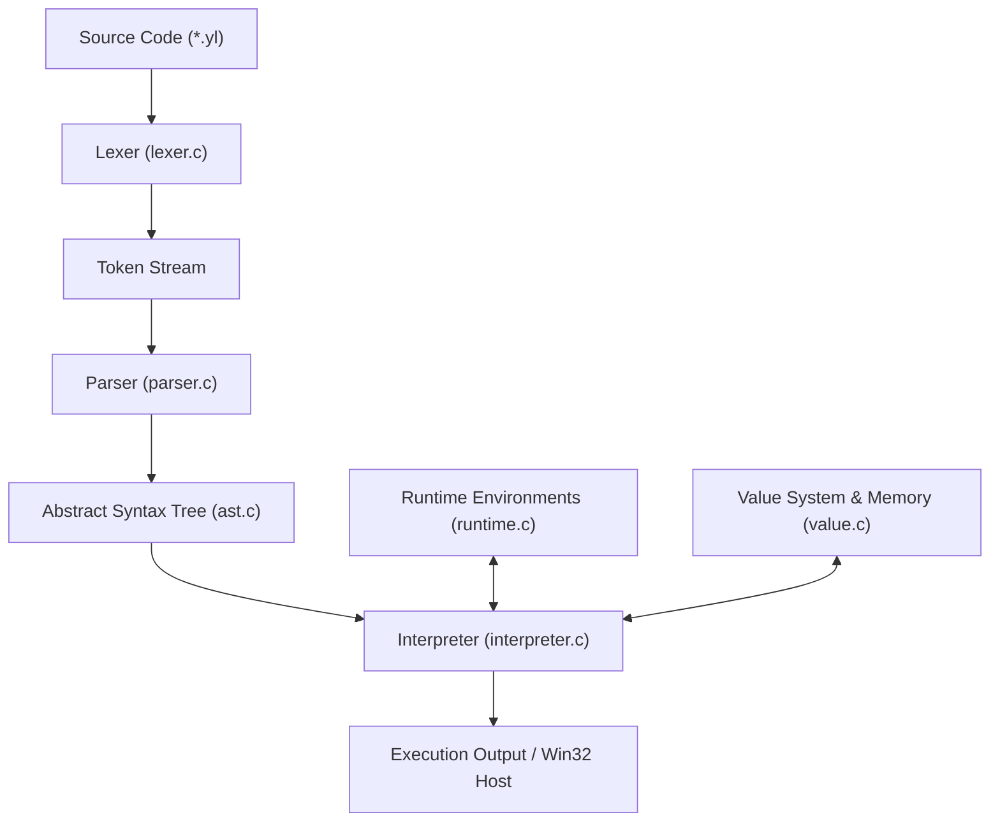
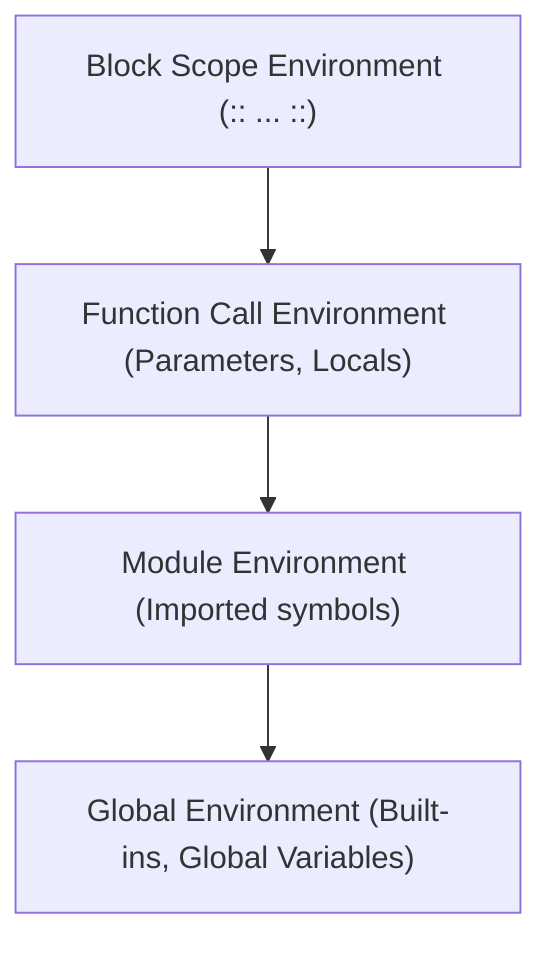
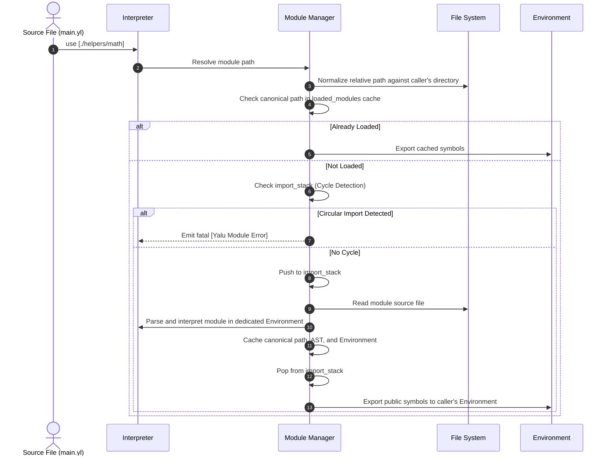

# Yalu Architecture and Implementation Guide (v0.3.0)

**Yalu** is an independent programming language implemented in pure C (C11 standard) with zero third-party dependencies outside the C standard library and Win32 console APIs.

---

## 1. Execution Pipeline

The Yalu interpreter operates as a classic tree-walking pipeline: source code is scanned into tokens, parsed into an Abstract Syntax Tree (AST), checked for semantic validity, and interpreted within lexically scoped environments.



---

## 2. Component Architecture

### 2.1 Lexer (`src/lexer.c`, `src/lexer.h`)
- **Linear Scanning**: Uses single-character lookahead (`peek`) and multi-character lookahead (`peek_next`, `peek_at`) to distinguish ambiguous tokens.
- **Source Tracking**: Every token encapsulates a `SourcePos` structure tracking the source filename, line number, and column number.
- **Distinctive Token Delimiters**:
  - `<<"" ... "">>`: Comments and section markers.
  - `<<""else"">>`: Contextually distinguished as an `else` branch delimiter.
  - `""\n...""`: Multiline strings preserving whitespace and line endings.
  - `::`: Block delimiter (opens and closes blocks).
  - `!!`: Condition delimiter for `if`, `:ei`, `lp`, and `fr`.
  - `!!< ... >>!!` / `>>`: Parameter list delimiters for functions and methods.
  - `..`: Key-value separator for Book dictionaries.
  - `<>`: List concatenation and multi-key/value declaration operator.
  - `>-`, `<-`, `N!`: Native relational and equality operator tokens.

### 2.2 Parser & AST (`src/parser.c`, `src/parser.h`, `src/ast.c`, `src/ast.h`)
- **Parsing Strategy**: Recursive descent parsing combined with operator precedence climbing for arithmetic, logical, relational, and collection expressions.
- **Abstract Syntax Tree**: Every grammar construct corresponds to a typed `ASTNode` allocated dynamically:
  - `AST_PROGRAM`, `AST_BLOCK`: Program and scoped statement sequences.
  - `AST_USE`: Module import statement.
  - `AST_CLASS_DECL`: Class definition containing method declarations.
  - `AST_NEW_OBJECT`: `/ClassName(...)` constructor invocation.
  - `AST_METHOD_CALL`: Object method call (`target>>method(...)`).
  - `AST_BOOK_LIT`: Book dictionary literal with key-value entries.
  - `AST_RANGE`: Numeric range generator (`start@end@step`).
  - `AST_FOR`: For-loop construct supporting ranges, collections, and separator parameter `j`.
  - `AST_WHILE`: While-loop construct.
  - `AST_IF`: Multi-branch conditional statement (`if`, `:ei`, and `<<""else"">>`).
  - `AST_RETURN`: Early return (`place` or `rt`).
  - `AST_STRING_INTERP`: Decomposed string interpolation tree (`/#ident` and `/#ident>prop`).
- **Error Synchronization**: Employs panic-mode recovery to synchronize at statement boundaries, preventing cascading error noise.

### 2.3 Value System & Memory Management (`src/value.c`, `src/value.h`)
Yalu represents runtime values using a tagged union `Value`:

```c
typedef struct Value {
    ValueType type;
    union {
        bool boolean;
        int64_t integer;
        double floating;
        StringObj* string;
        ArrayObj* array;
        struct BookObj* book;
        BookCollectionObj* book_coll;
        FunctionObj* function;
        NativeFn native_fn;
        ClassObj* klass;
        struct InstanceObj* instance;
    } as;
} Value;
```

#### Memory Management Strategy
1. **Reference Counting**: Heap-allocated objects (`StringObj`, `ArrayObj`, `BookObj`, `ClassObj`, `InstanceObj`) contain an internal `refcount`.
2. **Explicit Retain/Release**: Memory transitions are governed through `value_retain()` and `value_release()`.
3. **Cycle Guards & Recursion Protection**:
   - `InstanceObj` and `BookObj` maintain `in_repr` recursion flags during string serialization to prevent infinite loops when circular references exist.
   - The interpreter enforces a maximum call depth (`YALU_MAX_CALL_DEPTH = 500`) to detect runaway recursive functions safely.

---

## 3. Runtime & Environments (`src/runtime.c`, `src/runtime.h`)

Yalu scopes are managed via hierarchical `Environment` structures:



- **Lexical Resolution**: Lookups check the local environment first and traverse the `parent` chain upward.
- **Symbol Export**: When a module is loaded via `use`, `env_export_symbols()` selectively merges top-level module definitions into the importing environment.
- **Built-in Global Table**: Pre-populates built-in functions:
  - `type(...)`: Returns uppercase type name string.
  - `len(collection)`: Returns length of string or array.
  - `push(array, item)`: Appends an item to an array.
  - `pop(array)`: Removes and returns the last element of an array.

---

## 4. Module Resolution Engine

Yalu's module loading process guarantees that dependencies execute exactly once and circular imports are rejected cleanly:



---

## 5. Diagnostic and Error Reporting Engine (`src/errors.c`, `src/errors.h`)

Yalu formats compile-time and runtime diagnostics with source previews and caret pointers:

```text
[Yalu Syntax Error] examples/demo.yl:12:5: Expected '!!' before while loop condition
    | lp condition ::
    |    ^
```

- **Line Buffering**: Error handlers look up the offending line in the loaded source buffer.
- **Column Positioning**: Computes exact tab-adjusted visual indentation for the caret `^`.
- **Error Categories**:
  - `[Yalu Syntax Error]`
  - `[Yalu Type Error]`
  - `[Yalu Runtime Error]`
  - `[Yalu Module Error]`
  - `[Yalu Input Error]`
